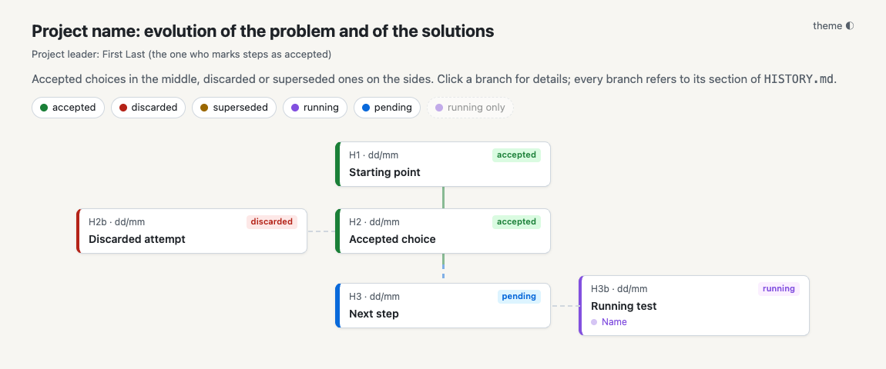
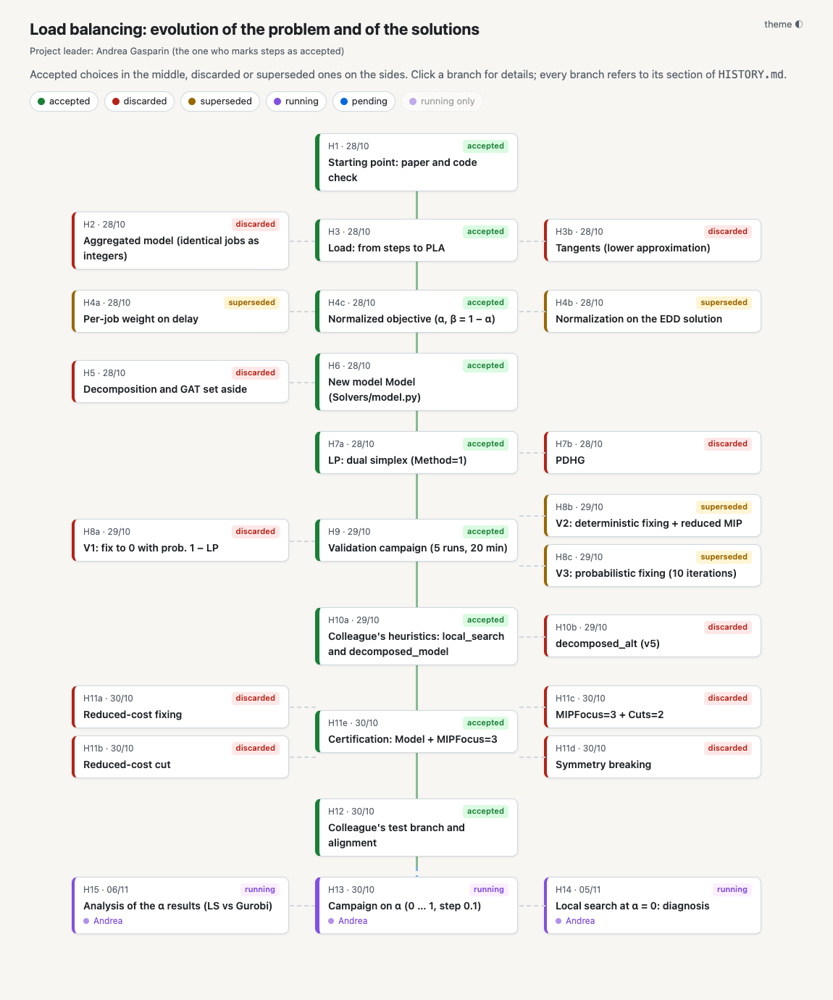
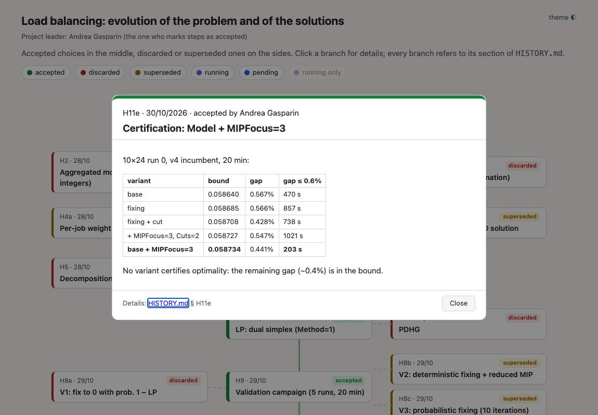
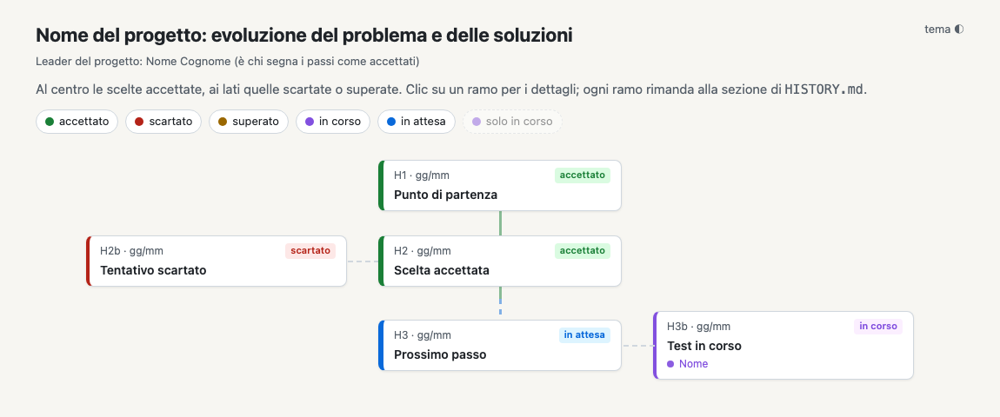
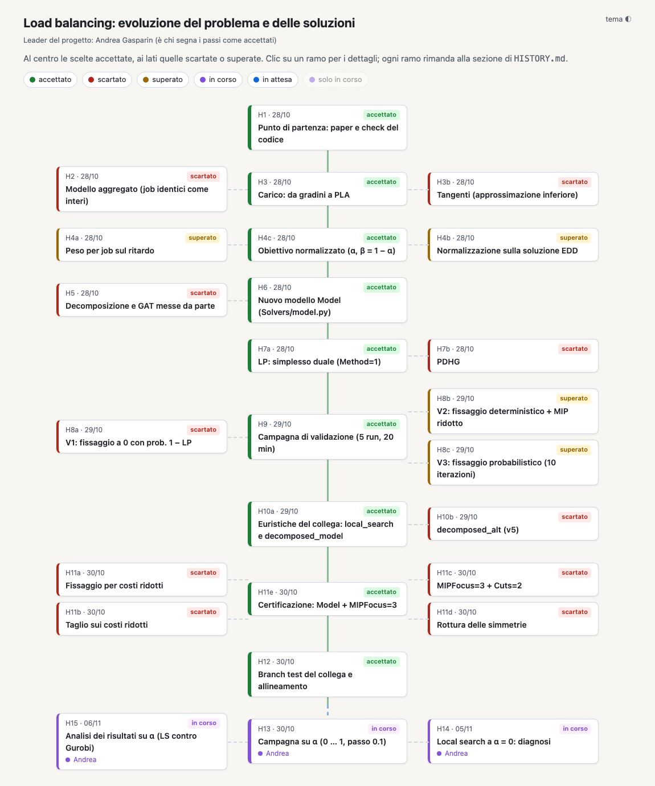
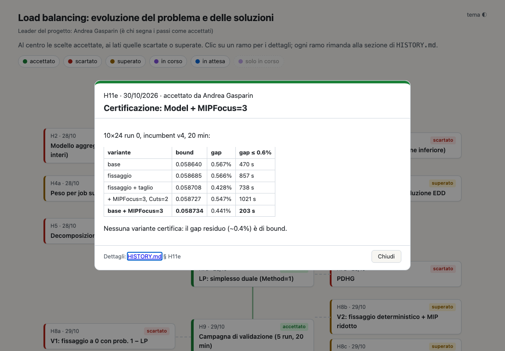

# Project log

[English](#english) · [Italiano](#italiano)

---

## English

A lightweight project log: where the project is now, every step that was tried (accepted, discarded or superseded)
with its numbers and reasons, and what is left to do. It is plain Markdown plus one HTML page that draws the history
as an interactive tree, and Claude sessions can read and update it as well as people.

### Folders

| Folder | What it is | Copy it into a project? |
|---|---|---|
| `template_english/` | Empty log, in English | **Yes**: copy this one *or* the Italian one |
| `template_italian/` | The same empty log, in Italian | **Yes**: copy this one *or* the English one |
| `andrea_example/` | A real, filled-in log (Andrea Gasparin's *Load balancing* project, in Italian), only to show what a log looks like after some work | **No** |
| `docs/` | Images of this page (`en/`, `it/`) | **No** |

Only a template goes into a project. The two templates are independent and complete: pick one language and copy
only that folder. How to fill it in, and the rules (statuses, project leader, instructions for Claude), are in the
`README.md` inside the template, which travels with the copy.

### How to start

1. Copy `template_english/` into your project and rename it `project_log/`.
2. Open `project_log/README.md` and follow it.

### What it looks like

Open `history_tree.html` in a browser (double-click, no server needed). Accepted steps form the green central branch;
discarded (red), superseded (yellow) and running (purple, with who is running them) attempts hang off the sides.

Right after copying the template:

After some days of work (the example project):

Clicking a node opens its summary, with a link to the matching section of `HISTORY.md`:

---

## Italiano

Un diario di progetto leggero: dove si trova il progetto, ogni passo provato (accettato, scartato o superato) con
numeri e motivi, e cosa resta da fare. È fatto di file Markdown e di una pagina HTML che disegna la storia come un
albero interattivo; lo leggono e lo aggiornano sia le persone sia le sessioni di Claude.

### Cartelle

| Cartella | Cos'è | Va copiata in un progetto? |
|---|---|---|
| `template_english/` | Diario vuoto, in inglese | **Sì**: questa *oppure* quella italiana |
| `template_italian/` | Lo stesso diario vuoto, in italiano | **Sì**: questa *oppure* quella inglese |
| `andrea_example/` | Un diario reale già compilato (progetto *Load balancing* di Andrea Gasparin), solo per mostrare come appare dopo un po' di lavoro | **No** |
| `docs/` | Immagini di questa pagina (`en/`, `it/`) | **No** |

In un progetto va solo un template. I due template sono indipendenti e completi: scegliere una lingua e copiare solo
quella cartella. Come compilarlo e le regole (stati, leader del progetto, istruzioni per Claude) sono nel `README.md`
dentro il template, che viene copiato insieme al resto.

### Come iniziare

1. Copiare `template_italian/` nel proprio progetto e rinominarla `project_log/`.
2. Aprire `project_log/README.md` e seguirlo.

### Come appare

Aprire `history_tree.html` nel browser (doppio clic, non serve un server). I passi accettati formano il ramo centrale
verde; i tentativi scartati (rosso), superati (giallo) e in corso (viola, con chi li sta facendo) stanno sui lati.

Appena copiato il template:

Dopo qualche giorno di lavoro (il progetto di esempio):

Clic su un nodo: si apre il riassunto, con il rimando alla sezione corrispondente di `HISTORY.md`:

